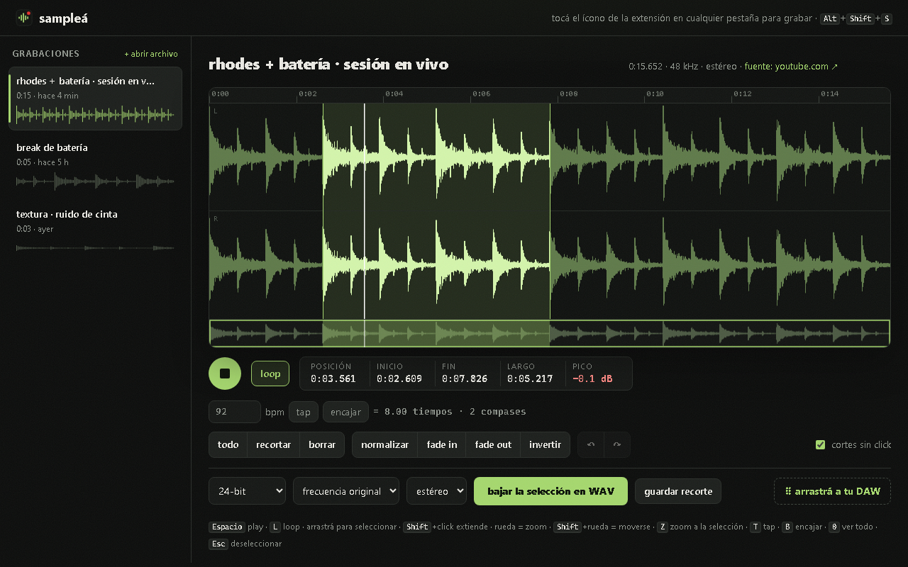

# sampleá

Extensión de navegador para **samplear directo desde una pestaña**: grabás el audio que suena en cualquier página, lo recortás y lo bajás en WAV para tu DAW.

**Página:** https://pedrofelipe14.github.io/samplea/ · **Bajar:** [última versión](https://github.com/pedrofelipe14/samplea/releases/latest)



- **Sin pérdida**: graba el audio crudo de la pestaña (float 32, 48 kHz estéreo), no un MP3 ni un Opus.
- **Seguís escuchando** la pestaña mientras grabás.
- **Editor** con forma de onda estéreo, zoom, selección, loop, cortes sin click (ajusta al cruce por cero), recortar, borrar, normalizar, fades, invertir y deshacer.
- **Exporta** WAV de 16 o 24 bits o de 32 bits float, a la frecuencia original, 44,1 o 48 kHz, estéreo o mono. Podés bajar todo o solo la selección, o **arrastrarlo directo a tu DAW**.
- **Biblioteca**: las grabaciones y los recortes quedan guardados en el navegador.
- **Loops al tempo**: tap tempo, cuántos tiempos o compases dura la selección y **encajar**, que ajusta la selección a compases exactos para que el loop cierre perfecto.
- Podés **abrir archivos de audio** (arrastrándolos al editor) para cortarlos con las mismas herramientas.
- Todo pasa en tu computadora: no se manda audio a ningún servidor.

## Instalarla

Mientras sale en la Chrome Web Store:

1. Bajá el `.zip` de la [última versión](https://github.com/pedrofelipe14/samplea/releases/latest) y descomprimilo (o cloná este repo).
2. Abrí `chrome://extensions` (o `edge://extensions`).
3. Activá **Modo desarrollador**.
4. Tocá **Cargar descomprimida** y elegí la carpeta.
5. Fijá el ícono en la barra (el alfiler del menú de extensiones).

## Usarla

1. Andá a la pestaña donde suena lo que querés samplear.
2. Tocá el ícono de sampleá (o `Alt+Shift+S`) y apretá el botón rojo.
3. Cuando pares, se abre el editor con la grabación (el silencio del principio y del final se recorta solo).
4. Seleccioná arrastrando sobre la onda, ajustá, y tocá **bajar en WAV** o arrastrá **«arrastrá a tu DAW»**.

Atajos del editor: `Espacio` play · `L` loop · `T` tap tempo · `B` encajar · `Shift`+click extiende la selección · rueda = zoom · `Shift`+rueda = moverse · `Z` zoom a la selección · `0` ver todo · `C` recortar · `N` normalizar · `R` invertir · `Supr` borrar · `Ctrl+Z` deshacer.

## Cómo funciona

- `src/background.js` (service worker) pide el stream de la pestaña con `chrome.tabCapture.getMediaStreamId` y crea un documento offscreen.
- `src/offscreen.js` graba con un AudioWorklet (`src/lib/recorder-worklet.js`) y reenvía el audio a los parlantes, porque capturar una pestaña la silencia.
- Las grabaciones se guardan en IndexedDB (`src/lib/db.js`) y el editor (`src/editor.js`) las lee desde ahí.
- `src/lib/wav.js` codifica el WAV y `src/lib/dsp.js` tiene las operaciones de edición.

No tiene dependencias ni paso de build: es JavaScript plano.

## Desarrollo

```sh
npm test        # tests del codificador WAV y de las operaciones de edición (Node 20+)
npm run icons   # regenera los PNG desde icons/icon.svg (usa Edge/Chrome headless)
npm run zip     # arma dist/samplea-<versión>.zip para subir a la tienda (Windows)
```

## Publicación

Los textos, las imágenes y los pasos para la Chrome Web Store y Edge Add-ons están en [STORE.md](STORE.md). La [política de privacidad](https://pedrofelipe14.github.io/samplea/privacy.html) y la página viven en `docs/` (GitHub Pages).

## Permisos

- `tabCapture`: grabar el audio de la pestaña cuando tocás el botón.
- `offscreen`: el documento invisible que graba mientras el popup está cerrado.
- `unlimitedStorage`: guardar grabaciones largas en la biblioteca.

## Ojo

Respetá los derechos de autor del material que sampleás.

## Licencia

MIT
